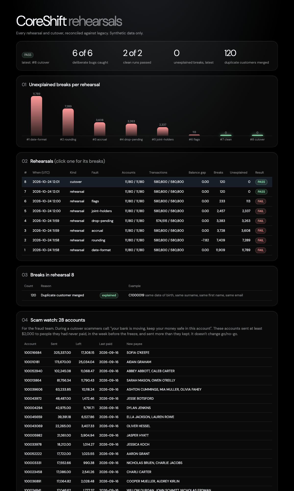

# CoreShift

Move a bank's accounts from an old core banking system to a new one, and prove that not a cent went missing on the way.

When two banks merge, one of them eventually moves every account onto the other's core system. Copying the data is the easy part. The hard part is proving afterwards that every account and every transaction arrived intact, and having a way back if they didn't. CoreShift is a working model of that job, built on synthetic data.



The dashboard above tells the story of one afternoon's rehearsals: a mapping with four bugs in it, each one caught and named by the reconciliation, fixed one at a time until the breaks hit zero, then a real cutover that committed.

## Run it

You need the .NET 10 SDK and Docker (Docker Desktop or Colima).

```bash
db/load-legacy.sh 5000                                    # build a 5,000-customer legacy bank in SQL Server
dotnet run --project CoreShift.Migrator -- rehearse       # a full cutover as a dry run
dotnet run --project CoreShift.Migrator -- dashboard      # then open http://localhost:5080
```

The first run writes a random SQL Server password to `.env`, which git ignores. The other commands are `migrate`, `reconcile`, `cutover` and `resume`; run the tool with no arguments to see them all.

## How it works

The project follows a cutover from end to end, in seven stages.

| Stage | What it does |
|---|---|
| 1. Legacy bank | Generates a synthetic bank one household at a time, with realistic products and deliberately messy legacy data |
| 2. Legacy load | Bulk-loads the bank into SQL Server and refuses to finish unless control totals match to the cent |
| 3. Mapping | Moves legacy into a clean target schema using versioned rules in a config file, in cohorts, and merges duplicate customers |
| 4. Reconciliation | Compares the two sides in independent SQL and files every difference as a break with a reason |
| 5. Tests and CI | 26 unit tests, plus a pipeline that runs a full rehearsal and fails on any unexplained break |
| 6. Cutover | A state machine that freezes legacy, migrates, reconciles, decides go or no-go, then commits or rolls back, and survives being killed half-way |
| 7. Dashboard | Rehearsal history, breaks by reason and the latest run's audit log |

### The legacy bank

Customers come with a job and an income that fits it, KYC and AML status, tax residency, and a credit bureau check if they've applied for credit. Accounts cover everyday, offset, savings, term deposits, home loans, personal loans and credit cards, including joint accounts, closed accounts, dormant accounts and deceased estates. About three and a half months of day-to-day banking sits behind every balance, so each balance is exactly the sum of its own history.

It's also messy on purpose, because real legacy data is. Some customers were keyed in twice, with a typo or with the day and month of their birthday swapped. Dates come in two formats depending on whether the record predates a 2010 system upgrade. Names have stray spaces, BSBs are missing their dash, phone numbers come in three spellings, and long account names were cut off at 30 characters.

### Mapping

`mapping/mapping.v1.json` says which legacy column feeds which target column, and through which rule: trim it, fix its capitals, read either date format, add the BSB dash, turn three phone spellings into one, or look a code up in the new product catalogue. A code the file doesn't know stops the migration instead of slipping through blank. Every run records the mapping version.

Duplicate customers are matched on postcode and suburb, then a birthday (or the same with day and month swapped), a surname within two edits, and a first name that agrees or is the right initial. The 5,000-customer bank has 120 planted duplicates; the matcher finds exactly 120. Accounts move in cohorts of 1,000, and each cohort is deleted and reinserted inside one transaction, so running the migration twice gives exactly the same result as running it once.

### Reconciliation

`db/06-reconcile.sql` never calls the mapping code. It reads both sides with its own SQL, so a bug in the mapping can't hide itself. It checks record counts, the bank-wide balance, every account's balance and accrued interest, open dates, and a SHA-256 of each account's ordered transaction history. Merged duplicates are filed as explained breaks with their evidence; anything else is unexplained and means no-go.

Each of the four deliberate mapping bugs (`--fault`) is caught and named:

| Bug injected | What the reconciliation reported |
|---|---|
| Balances rounded to dollars | 7,312 balances rounded to whole dollars, bank total $4.82 out |
| Pending card transactions dropped | 3,263 accounts with pending transactions not migrated |
| Dates read month-first | 3,945 open dates read as MM/dd, 7,844 histories altered |
| Accrued interest not carried | 3,608 accounts with interest accrual timing breaks |

### Cutover

`STARTED → FROZEN → EXTRACTED → TRANSFORMED → LOADED → RECONCILED → GO or NO_GO → COMMITTED or ROLLED_BACK`

While a run is going, triggers on the legacy tables refuse every write, and a fingerprint taken at extract proves nothing changed. The state is saved after every step and each cohort commits together with its "loaded" mark, so a run that dies anywhere picks up where it stopped with `resume`. A no-go empties the target and unfreezes legacy in one transaction. `rehearse` runs the same thing as a dry run that always rolls back.

These were tested against a real database: a crash inside a cohort, a real `kill -9` mid-load (7 of 44 cohorts committed, no half-written rows, `resume` finished the rest), a write to frozen legacy, a second run started while one was unfinished, and a no-go rollback that left legacy byte-for-byte unchanged.

## What testing turned up

Stress and failure testing found real bugs, and honestly they taught me more than building the thing did.

- The database total came out 11 cents short of the generator's. Fortnightly home loans carried fractions of a cent, and the CSV rounded them away. The generator's own check missed it because both sides of its comparison carried the same fractions. The control totals check came out of this one, and so did the rule that the reconciliation never shares code with the mapping.
- Holding the whole bank in memory took 1.1 GB at 20,000 customers. Writing each household out as soon as it's done keeps it at about 60 MB, even at 100,000.
- Under SQL Server's default FULL recovery model, one big load grew the transaction log to 2.1 GB. This database gets rebuilt every time, so it now runs in SIMPLE recovery: 72 MB, and faster.
- Deleting and regenerating the output folder left the container looking at a folder that no longer existed. The container now mounts the project root instead.
- After a restart, the container reported healthy before the database had finished opening. The health check now reads from the database itself.
- The reconciliation first labelled 33 rounded balances as plain differences. They were exact 50-cent amounts, where C#'s round-half-to-even and SQL's round-half-up disagree.

## Scale

| Customers | Transactions | Generate | Peak memory | Load into SQL Server |
|---|---|---|---|---|
| 5,000 | 0.6 million | 4 s | 61 MB | 10 s |
| 100,000 | 11.6 million | 39 s | 61 MB | about 4 min |

A full cutover of the 5,000-customer bank takes about 25 seconds. At 750,000 customers I'd generate households in parallel (they don't depend on each other), split the extract into several files and load them side by side, and run cohorts on several connections at once, since each one is already its own transaction. I haven't tried any of that yet.

## Layout

```
CoreShift.Generator/   the synthetic legacy bank (C#, Bogus)
CoreShift.Migrator/    the coreshift tool: migrate, reconcile, rehearse, cutover, resume, dashboard
CoreShift.Tests/       xUnit tests
mapping/               versioned mapping rules
db/                    legacy and target schemas, load, checks, reconciliation, practice queries
ci/                    the rehearsal CI runs
azure-pipelines.yml    Azure DevOps pipeline; .github/workflows/ci.yml runs the same steps on GitHub
```

Kubernetes was optional in the plan and isn't here. The whole thing runs in one SQL Server container and one console app.

## Synthetic data only

Everything here is made up. There are no real banks, people, tax file numbers, licence numbers or card numbers. Emails use reserved example domains, and the BSB prefix and business names are invented.
